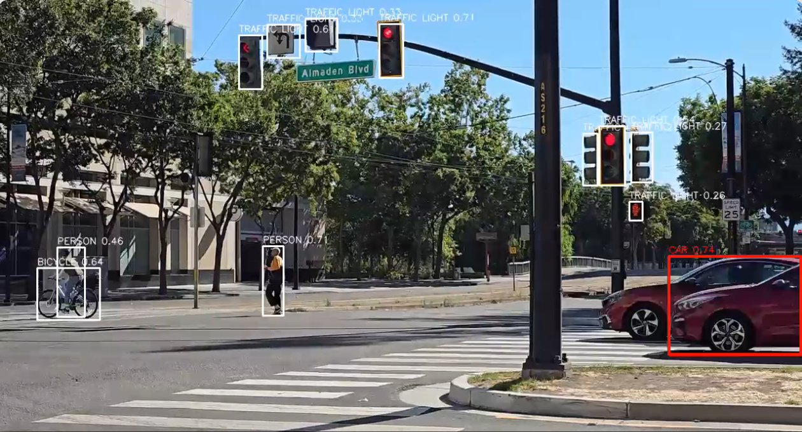

# Detection-to-VLM Assistant (YOLO11 + Vision-Language Model)

## Table of Contents

- [Introduction](#introduction)
- [About Project](#about-project)
- [Pipeline Shape](#pipeline-shape)
- [Full Architecture](#full-architecture)
- [Split Validation — read this](#split-validation--read-this)
- [Requirements](#requirements)
- [Model Download](#model-download)
- [Configure](#configure)
  - [Config parameters](#config-parameters)
- [How To Run (human UX)](#how-to-run-human-ux)
- [How To Run (CI / automation fallback)](#how-to-run-ci--automation-fallback)
- [How To See The Output](#how-to-see-the-output)
- [Expected Output](#expected-output)
- [Visualization — boxes over UDP (H.264/RTP)](#visualization--boxes-over-udp-h264rtp)
  - [How the VLM box is chosen (what the red box means)](#how-the-vlm-box-is-chosen-what-the-red-box-means)
- [Colour Correctness (a real trap)](#colour-correctness-a-real-trap)
- [Direct `VisionLanguageModel` vs `GenAIServer`](#direct-visionlanguagemodel-vs-genaiserver)
- [Verified](#verified)
- [Notes](#notes)

---

## Introduction

An **always-on YOLO11 detector** watches a video stream (or a folder of images).
Selected detections are cropped and handed to a **vision-language model (VLM)**, which
returns a natural-language description of the crop. Output = detections **plus** a caption.

This is **trigger-based multimodal**: the detector is cheap and runs on every frame; the
VLM is expensive (seconds per call) and fires **only** on interesting, de-duplicated
events. A bounded background worker absorbs VLM latency so the detection loop never blocks.

Adapted from
[`detection-to-vlm-assistant`](https://github.com/sima-neat/apps/tree/main/examples/genai/detection-to-vlm-assistant)
(crop-to-VLM shape) and [`multi-stream-yolo-yolo11`](../multi-stream-yolo-yolo11/README.md) (its
YOLO11 detection pattern).



*Detections with the box the VLM is captioning in red, viewed in Neat Insight.*

## About Project

- Application: `detection-vlm-assistant` (`main.py` + `src/vlm_commenter.py`)
- Detector model: `yolo_11n_mpk.tar.gz`, YOLO11n from the SiMa Model Zoo (see
  [Model Download](#model-download))
- VLM model: `Qwen3-VL-4B-Instruct-Autoround-a16w4`, deployed on the DevKit with `llima pull`
  (see [Model Download](#model-download))
- Input: one RTSP H.264 stream **or** still image(s)
- Output: per-frame detection log + VLM caption per selected crop
- Runtime config: `./config/default.conf`

## Pipeline Shape

<details>
<summary>Click to expand</summary>

<br>

```
frame (RTSP NV12 -> BGR, or still image BGR)
        |
        v
  YOLO11 detector (Neat model-managed box decode, BoxDecodeType.YoloV8)    <- cheap, every frame
        |
        v
  trigger gate (class allow-list + min score + min area) + dedup (IoU/cooldown) + rate limit
        |
        v
  bounded background VLM worker  ->  pyneat.genai.VisionLanguageModel  ->  caption   <- expensive, gated
```

References:
[`detection-to-vlm-assistant`](https://github.com/sima-neat/apps/tree/main/examples/genai/detection-to-vlm-assistant)
(crop-to-VLM), [`multi-stream-yolo-yolo11/main.py`](../multi-stream-yolo-yolo11/main.py) (detector,
`push`+`pull("detections")`, `pyneat.decode_bbox`), the Neat core `VisionLanguageModel` and GenAI
types, and [`llima/02-run-llm-vlm/02_run_vlm.ipynb`](../../llima/02-run-llm-vlm/02_run_vlm.ipynb).

</details>

## Full Architecture

<details>
<summary>Click to expand</summary>

<br>

Two decoupled legs share each frame. The **detector** runs every frame (cheap) and feeds
both the **VLM leg** (gated / dedup'd / rate-limited, bounded background worker, never
blocks the loop) and the **video leg** (overlay + UDP). The VLM leg and video leg agree on
which box is "the subject" through the same `_passes_gate` logic — `on_frame` uses it for
the real send, `gate_candidate` uses it (non-mutating) for the red highlight.

```
                          RTSP H.264 stream (camera / Insight RTSP source)
                                        |
                                        v
             +----------------------------------------------------+
             |  make_rtsp_source: pyneat.groups.rtsp_decoded_input |  NV12 out, Realtime/KeepLatest
             +----------------------------------------------------+
                                        |  source_run.pull_tensors()
                                        v
                        decoded_tensor_to_bgr()  -> clean BGR frame ----------------+
                                        |                                           | (clean copy)
                                        v                                           |
     +-------------------------------------------------------+                      |
     |  detect(): push([BGR]) -> pull("detections")          |  YOLO11n             |
     |  -> pyneat.decode_bbox() -> boxes[x1,y1,x2,y2,score,c] |  (YoloV8 head + NMS) |
     +-------------------------------------------------------+                      |
                                        |                                           |
                 +----------------------+-----------------------+                   |
                 v (every frame, cheap)                         v                   |
   +------------------------------+          +-------------------------------------+-----------+
   | VlmCommenter.on_frame(boxes) |          | gate_candidate(boxes) -> the ONE red box (viz)  |
   |  rate-limit -> gate -> dedup |          +----------------------+--------------------------+
   |  -> crop CLEAN frame -> queue|                                 v
   +--------------+---------------+          +------------------------------------------------+
                  v (bounded, background)    | draw_boxes(): white = all, red = gate_candidate |
   +------------------------------+          +----------------------+--------------------------+
   | worker thread:               |                                 v
   |  dry-run -> log crop+prompt  |          +------------------------------------------------+
   |  real    -> VisionLanguageModel         | bgr_to_nv12() -> make_nv12_tensor() -> push     |
   |            .run(GenReq) caption          | VideoSender: H.264 encode -> RTP -> UDP :port  |
   +------------------------------+          +----------------------+--------------------------+
        stdout captions                                             v
                                                     UDP H.264/RTP -> your gst viewer
```

Key point: the VLM crop is taken from the **clean** BGR frame inside `on_frame(...)`
*before* `draw_boxes(...)` runs, so the white/red overlay never leaks into the image
handed to the VLM. The video leg only runs in RTSP mode when `udp_host` is set; image
mode is stdout-only.

</details>

## Split Validation — read this

<details>
<summary>Click to expand</summary>

<br>

The two legs are validated differently on purpose:

- **Detection leg:** runs on its own. RTSP or still image in -> real detections out.
- **VLM leg:** needs a deployed VLM. Without one, run in **dry-run** mode: the app logs the
  selected crop and the **exact prompt that WOULD be sent**, and never loads or calls the VLM.

Both legs were run end to end on Neat 0.5.0 (see "Verified" below).

Dry-run turns on automatically when `--no-vlm` is passed, when `vlm_enabled=false`, or when
the configured `vlm_model_dir` is missing. This is also how you validate the detection leg
without a VLM present, and it is genuinely useful for tuning the trigger/prompt.

</details>

## Requirements

Run on the DevKit. `pyneat` 0.5.0, `numpy`, and OpenCV (`cv2`) must be importable there.
`/workspace` is NFS-mounted on the board at the same path, so write host-side and run
board-side — no copying.

```bash
cd /path/to/demo-neat/apps/detection-vlm-assistant
```

## Model Download

`./assets/models/` is git-ignored, so a fresh clone has no models. Get both before running.

**Detector.** Download YOLO11n from the SiMa Model Zoo, from the app directory:

```bash
cd assets/models
sima-cli modelzoo -v 2.1.3 --boardtype modalix get yolo_11n   # -> yolo_11n_mpk.tar.gz
cd ../..
```

`model_name=yolo11` decodes it with `BoxDecodeType.YoloV8`, which runs NMS on the board.

**VLM (only for real captions; skip it for dry-run).** Deploy it on the DevKit with LLiMa:

```bash
df -h /media/nvme                                      # check free space first
llima pull Qwen3-VL-4B-Instruct-Autoround-a16w4
llima list                                             # confirm it is deployed
```

It lands in `/media/nvme/llima/models/Qwen3-VL-4B-Instruct-Autoround-a16w4`, which is what
`vlm_model_dir` in the config points at. Another deployed VLM works too: pull it and point
`vlm_model_dir` at its directory. `Qwen3-VL-4B-Instruct-GPTQ-a16w4` and the much smaller
`LFM2.5-VL-450M-Autoround-a16w4` are alternatives. See
[`llima/`](../../llima/README.md) for LLiMa itself.

## Configure

Edit `./config/default.conf`. At minimum for the RTSP demo:

```text
source=rtsp
rtsp_url=<rtsp-url>
model_path=./assets/models/yolo_11n_mpk.tar.gz
udp_host=<host-ip>
vlm_trigger_classes=car
```

Replace both placeholders: the app stops with an error while `rtsp_url` (or, with video on,
`udp_host`) still holds one. `udp_host` is the Insight host that receives the annotated video;
leave it empty for stdout only. `vlm_trigger_classes` picks which detections get a caption (the shipped config uses `car`;
set it to `person`, or a comma-separated list, to suit your scene).

> **Resolution and frame rate are read from the camera at start.** `width`, `height` and `fps`
> in the config are used only if that fails; then set them to your camera's values.
> Reading the camera needs `ffprobe` on the DevKit (`sudo apt install ffmpeg`). If it fails, the
> `[warn] could not probe ...` line says why (for example `ffprobe not installed`).

### Config parameters

<details>
<summary>Click to expand</summary>

<br>

- `source`: `rtsp` (always-on demo) or `image` (still file / directory / glob).
- `rtsp_url`, `rtsp_transport`, `latency_ms`: RTSP input.
- `image_path`: file, directory, or glob for `source=image`.
- `model_path` / `models_dir` / `model_name`: detector archive and decode family
  (`yolov8`/`yolo11` => `BoxDecodeType.YoloV8`, `yolo26` => `BoxDecodeType.YoloV26`).
- `width`, `height`, `fps`: fallback, used only if the camera cannot be read.
  `probe_source`: `true` reads them from the camera at start; `false` uses the values in the config.
- `model_width`, `model_height`: compiled model input size (Neat letterbox-resizes to it).
- `score_threshold`, `nms_iou`, `top_k`: box-decode controls.
- `frames`: frames to process; `0` runs until interrupted (rtsp) / processes all images.
- `duration_s`: wall-clock limit in seconds (rtsp); `0` = no limit. Same as `--duration`.
- `timeout_ms`: detector pull timeout in milliseconds.
- `source_timeout_ms`, `rtsp_stall_timeout_s`, `rtsp_reconnect_attempts`: RTSP resilience. One
  empty pull waits `source_timeout_ms`; only `rtsp_stall_timeout_s` of continuous silence counts
  as a dead stream, which is reconnected up to `rtsp_reconnect_attempts` times.
- `video_enabled`, `udp_host`, `udp_port` (or `udp_port_base`), `bitrate_kbps`: annotated video
  output; see [Visualization](#visualization--boxes-over-udp-h264rtp).
- **VLM trigger / commenter:**
  - `vlm_enabled`: master switch; `false` => dry-run.
  - `vlm_model_dir`: VLM directory on the board (real mode only).
  - `vlm_trigger_classes`: comma-separated COCO allow-list (empty = any class).
  - `vlm_trigger_min_score`, `vlm_trigger_min_area_frac`: confidence / size gating.
  - `vlm_interval_seconds`: minimum **wall-clock** seconds between VLM calls (rate limit).
  - `vlm_max_pending`: bounded in-flight/queued crops; a full queue drops the trigger.
  - `vlm_dedup_iou`, `vlm_dedup_cooldown_s`: treat a box as the same object at IoU ≥
    threshold; re-trigger only after the cooldown. Stops one object re-firing every frame.
  - `vlm_max_new_tokens`, `vlm_prompt`: generation controls. `{label}` in the prompt is
    substituted with the detected class.

The main values are also overridable on the command line; run `dk ./main.py --help` for the
flags.

</details>

## How To Run (human UX)

From the SDK shell, run it on the DevKit with `dk`.

Detection leg, dry-run VLM (validate live without a VLM):

```bash
dk ./main.py --config ./config/default.conf --no-vlm --frames 40
```

Still-image dry-run over a folder:

```bash
dk ./main.py --source image --image <folder-of-images> --no-vlm
```

Full pipeline with the real VLM (after deploying it; see [Model Download](#model-download)):

```bash
dk ./main.py --config ./config/default.conf     # vlm_enabled=true, model dir present
```

## How To Run (CI / automation fallback)

For CI or scripts, plain passwordless ssh works too. `/workspace` is NFS-mounted, so run the
same on-disk file (replace `/workspace/demo-neat` with where your clone is under `/workspace`):

```bash
timeout 200 ssh -o BatchMode=yes sima@<devkit-ip> \
  'source $HOME/pyneat/bin/activate; \
   cd /workspace/demo-neat/apps/detection-vlm-assistant; \
   python main.py --no-vlm --frames 40'
```

## How To See The Output

### Neat Insight (recommended)

When `video_enabled=true` the app publishes an annotated H.264/RTP stream (all boxes white, the
VLM-selected one red).

1. Open the Insight UI, **`https://<sdk-host-ip>:9900`** (`neat --json` shows it as
   `insight.webUiUrl`), in a browser. *It is **HTTPS**, not HTTP. The SDK uses a local mkcert
   certificate, so accept the browser warning the first time.*
2. Go to the **Video Viewer** tab.
3. Select channel **0** (UDP `9000`), which matches `udp_port=9000` in `./config/default.conf`.
   Insight ingests video on UDP `9000 + channel`.

`udp_host` must point at the machine running Insight. The number of video channels is set by the SDK's port map; read the range from `neat --json`
(`exposedPorts`, `videoUDP`).

The VLM captions are **not** drawn on the video — they go to stdout, as shown below.

## Expected Output

With the shipped config on a 1280×720 30 fps source and the VLM deployed, the start-up lines are:

```text
detector=yolo_11n_mpk.tar.gz decode=yolo11 vlm=/media/nvme/llima/models/Qwen3-VL-4B-Instruct-Autoround-a16w4
rtsp=<rtsp-url> stream=1280x720@30
video=udp://<host-ip>:9000 (all boxes white, VLM pick red)
viewer: gst-launch-1.0 -v udpsrc port=9000 ...
```

The first caption loads the VLM (about 10 s) and prints a `vlm: loaded ...` line. After that, a
60 s run (`dk ./main.py --duration 60`) prints lines like these:

```text
frame=1020 detections=9 fps=17.72
vlm[CAR score=0.89 bbox=(261, 402, 650, 533)]: A white sedan with sleek alloy wheels and a modern design is parked beside a silver vehicle, its side profile captured in a street-side security camera shot.  (30 tok, 13.8 tok/s, ttft=0.64s)
frame=1050 detections=10 fps=17.85
frame=1080 detections=13 fps=18.02
done: frames=1082 elapsed=60.1s avg_fps=18.00 vlm_captions=12 reconnects=0
```

The `fps=` value is the running average since start; it cannot exceed the source rate. Captions,
boxes and timings depend on the video and the model's sampling.

With `--no-vlm` (or no deployed VLM) the app runs in dry-run mode: the banner says
`vlm=DRY-RUN (crop+prompt logged, VLM not called)`, and each caption line is replaced by a
`vlm[dry-run] WOULD send crop -> VLM` block that lists the class and score, the box, the crop
shape, the model directory and the prompt.

## Visualization — boxes over UDP (H.264/RTP)

<details>
<summary>Click to expand</summary>

<br>

Like the sibling single-stream apps, RTSP mode can draw the detections on each frame
and stream the result as H.264/RTP over UDP. Colour convention:

- **every detection is drawn white**, and
- **the one box the VLM would caption this frame is drawn red** (highest-score box that
  clears the trigger gate — see "How the VLM box is chosen" below).

Enable it by pointing `udp_host` at the Insight host (video is on by default; leave
`udp_host` empty or pass `--no-video` for stdout-only detection):

```bash
dk ./main.py --config ./config/default.conf --udp-host <sdk-host-ip> --udp-port 9000 --no-vlm
```

Then open channel 0 (port 9000) in Insight's **Video Viewer**. The app also prints a
`gst-launch-1.0` command at startup; Insight is the supported way to view the stream.

Config keys: `video_enabled`, `udp_host`, `udp_port` (or `udp_port_base`), `bitrate_kbps`.
Implementation mirrors `single-stream-yolo-yolo11` (`VideoSenderOptions.h264_rtp_udp_from_raw`
+ `pyneat.groups.video_sender`); the frame is drawn in BGR, converted to NV12, and pushed.
The VLM crop is always taken from the **clean** frame *before* the overlay is drawn, so the
red/white boxes never leak into the image handed to the VLM.

### How the VLM box is chosen (what the red box means)

The red box is the highest-score detection that passes the trigger gate: class in
`vlm_trigger_classes` (`car` in the shipped config), `score >= vlm_trigger_min_score`, and area
`>= vlm_trigger_min_area_frac` of the frame. The *actual* VLM send additionally applies
the rate limit (`vlm_interval_seconds`), IoU/cooldown dedup (`vlm_dedup_iou`,
`vlm_dedup_cooldown_s`), and the bounded queue (`vlm_max_pending`); the red overlay
(`VlmCommenter.gate_candidate`) is non-mutating and shows the current subject every frame.

</details>

## Colour Correctness (a real trap)

<details>
<summary>Click to expand</summary>

<br>

VLM images must be **uint8 HWC RGB**. Crops here are OpenCV-native **BGR**, so
`src/vlm_commenter.py` calls `cv2.cvtColor(crop, cv2.COLOR_BGR2RGB)` **at the VLM request
boundary**. Skipping this silently feeds the VLM channel-swapped images and quietly degrades
every answer. The dry-run log prints the crop shape and reminds you of the conversion.

</details>

## Direct `VisionLanguageModel` vs `GenAIServer`

<details>
<summary>Click to expand</summary>

<br>

This app calls the VLM **in-process** via `pyneat.genai.VisionLanguageModel` — lowest
latency, no network hop, one model handle holding LM weights + vision encoder resident.
Use `GenAIServer` (OpenAI-compatible HTTP) instead only when the boundary is a network: a
browser UI or a separate service that should not link the Neat runtime. The upstream
[`detection-to-vlm-assistant`](https://github.com/sima-neat/apps/tree/main/examples/genai/detection-to-vlm-assistant)
uses the HTTP path; see [`llima/05-genai-server`](../../llima/05-genai-server/).

</details>

## Verified

<details>
<summary>Click to expand</summary>

<br>

With the shipped config, Neat 0.5.0, the Model Zoo `yolo_11n` and
`Qwen3-VL-4B-Instruct-Autoround-a16w4`, on a 1280×720 30 fps RTSP source, a 60 s run
(the shipped config has no time limit, so pass `--duration`):

```bash
dk ./main.py --duration 60
```

ends with:

```text
done: frames=1082 elapsed=60.1s avg_fps=18.00 vlm_captions=12 reconnects=0
```

- **Detections:** 7–15 per frame, one box per object (`YoloV8` decode, NMS on the device).
- **VLM:** a caption every 5 s, as configured, at about 13.8 tok/s and 0.6–0.9 s to the first token.
- **Frame rate:** the VLM shares the MLA, so each caption pauses detection. The average falls as the
  caption rate rises.

</details>

## Notes

<details>
<summary>Click to expand</summary>

<br>

- The detector uses `push([tensor])` + `pull("detections", ...)` (the same pattern as
  `multi-stream-yolo-yolo11`). The
  synchronous `run([...])` helper does **not** surface this archive's model-managed
  box-decode output — push + named pull does.
- `vlm_interval_seconds` is wall-clock: over a fast batch of still images only the first
  qualifying crop fires. That is intended for the always-on RTSP use case; lower it (or set
  it to 0) if you want a caption per image.

</details>
