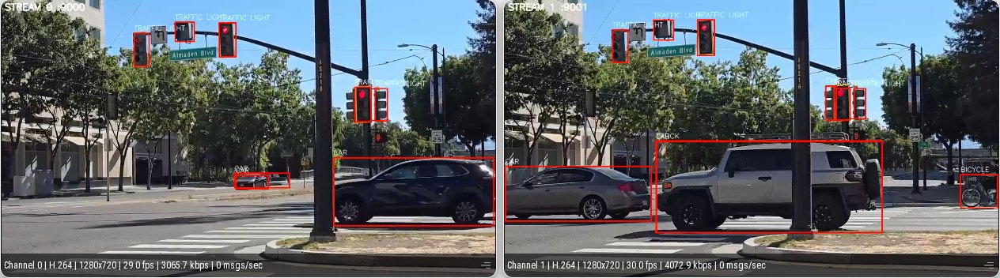

# Multi Stream YOLO11 Detection (2x RTSP)

## Table of Contents

- [Introduction](#introduction)
- [About Project](#about-project)
- [Requirements](#requirements)
- [Model Download Command](#model-download-command)
- [Configure](#configure)
- [Config Parameters](#config-parameters)
- [How To Run](#how-to-run)
- [How To See The Output](#how-to-see-the-output)
- [Appendix: Learnings](#appendix-learnings)

---

## Introduction

This demo runs two RTSP streams through one shared SiMa Neat YOLO11 object detection model, draws
decoded detections on NV12 frames, and publishes one annotated H.264/RTP UDP stream per input.

Both streams sustain the full 60 fps source rate with zero dropped frames. Stream identity is
preserved end to end: each stream owns its RTSP source, its UDP port, and an on-frame
`STREAM <id> :<port>` banner.



*Two RTSP streams through one shared YOLO11n model, viewed in Neat Insight.*

## About Project

- Application: `multi_stream_yolo_yolo11` (`main.py`, Python)
- Model: `yolo_11n_mpk.tar.gz` (one archive, shared by both streams)
- Input: 2x RTSP H.264 streams
- Output: 2x UDP/RTP H.264 streams with bounding boxes, one port per stream
- Runtime config: `./config/default.conf`

## Requirements

Run on the DevKit with `dk`. `pyneat` must be importable there. `/workspace` is NFS-mounted on the
board at the same path, so edit host-side and run board-side — no copying.

Run the commands below from this app folder:

```bash
cd /path/to/demo-neat/apps/multi-stream-yolo-yolo11
```

## Model Download Command

YOLO11 is published in the SiMa model zoo, so just download it:

```bash
mkdir -p ./assets/models
cd ./assets/models
sima-cli modelzoo -v 2.1.3 --boardtype modalix get yolo_11n
cd ../..
```

The zoo asset is named `yolo_11n_mpk.tar.gz`, which is exactly the path `./config/default.conf`
already expects — no config edit needed.

Expected model path:

```text
./assets/models/yolo_11n_mpk.tar.gz
```

The zoo publishes the whole detection family (`yolo_11n`, `yolo_11s`, `yolo_11m`, `yolo_11l`,
`yolo_11x`). To run a different size, `get` that name and point `model_path` at it. Both streams
share this one archive.

Only compile YOLO11 yourself for a variant the zoo does not publish — and note that a self-compiled
archive needs `model_name=yolo11`.

## Configure

Edit `./config/default.conf` before running. At minimum, set:

```text
rtsp_url_0=<rtsp-url>
rtsp_url_1=<rtsp-url>
model_path=./assets/models/yolo_11n_mpk.tar.gz
model_name=yolov8
udp_host=<host-ip>
udp_port_base=9000
udp_port_stride=1
```

The app stops with a message while `rtsp_url_0`, `rtsp_url_1` or `udp_host` still holds its `<...>`
placeholder, or if the `--config` file does not exist.

> **Resolution and frame rate are read from the camera at start.** `width`, `height` and `fps`
> in the config are used only if that fails; then set them to your camera's values.
> Reading the camera needs `ffprobe` on the DevKit (`sudo apt install ffmpeg`).
>
> Both cameras must have the same resolution.

Leave `model_name=yolov8` alone when running the zoo archive — despite the name, it is the decode
family, and it is the right one for zoo YOLO11. See `model_name` under
[Config Parameters](#config-parameters).

With those defaults stream 0 publishes on `9000` and stream 1 on `9001`, Insight viewer channels 0
and 1.

For a bounded smoke test, set `frames=30` in `./config/default.conf`.

## Config Parameters

<details>
<summary>Click to expand</summary>

<br>

`rtsp_url_0`, `rtsp_url_1`: The two RTSP H.264 input streams. Both ship as the `<rtsp-url>`
placeholder; set both, to the same source or to two distinct cameras. `rtsp_url` is accepted as
another name for `rtsp_url_0`.

`rtsp_transport`: RTSP transport mode. Use `tcp` for reliability or `udp` for lower latency.

`udp_host`: Host/IP that receives both annotated UDP/RTP output streams.

`udp_port_base`: UDP/RTP output port for stream 0. `udp_port` is accepted as another name for it.

`udp_port_stride`: Port spacing. Stream `i` publishes on `udp_port_base + i * udp_port_stride`.

`model_path`: Shared model archive loaded by the Neat model stage.

`models_dir`: Used only when `model_path` is empty: the app then loads `yolo_11n_mpk.tar.gz` from
this folder (default `./assets/models`).

`model_name`: Decode family. `yolov8` (default) is for the zoo `yolo_11n`: `BoxDecodeType.YoloV8`.
`yolo11` is for an archive built with `model-compilation/`, which keeps the same 64-channel DFL
heads but outputs class logits: `YoloV8` with `GroupedByRoleLogit`. `yolo26n` selects
`BoxDecodeType.YoloV26`, for YOLO26 models only. Any other value stops the app with an error.

`model_width`: Model input width used by Neat preprocessing.

`model_height`: Model input height used by Neat preprocessing.

`width`: Width of the RTSP stream. Fallback, used only if the camera cannot be read.

`height`: Height of the RTSP stream. Fallback, used only if the camera cannot be read.

`fps`: Frame rate of the RTSP stream (whole number). Fallback, used only if the camera cannot be read.

`probe_source`: `true` reads width, height and fps from the camera at start; `false` uses the values above.

`latency_ms`: RTSP receiver latency buffer in milliseconds.

`score_threshold`: Detection score threshold used by YOLO box decode.

`nms_iou`: NMS IoU threshold used by Neat decode. Ignored with `model_name=yolo26n` (the `YoloV26`
decoder runs no NMS).

`top_k`: Maximum decoded detections per frame.

`num_classes`: Number of classes in the model output.

`frames`: Number of frames to process PER stream. Use `0` to run until interrupted.

`warmup_frames`: Frames per stream excluded from the reported FPS and stage means. Graph build,
model load and RTSP jitter-buffer fill all land on the first few frames.

`model_queue_depth`: Frames the shared model Run keeps in flight. This is what pipelines the MLA.

`stream_queue_depth`: Bounded hand-off depth per stream (input queue and result queue).

`profile_interval`: Seconds between live time-profile tables (default `5`). `0` prints only the
summary at exit.

`decoder_buffers`, `decoder_input_buffers`, `decoder_tuning`: H.264 decoder buffer counts and
tuning mode (defaults `16`, `2`, `auto`). Leave them unless you know you need to change them.

`bitrate_kbps`: H.264 output encoder bitrate in kbps.

`print_backend`: Print generated backend pipelines when set to `true`.

The main values are also overridable on the command line (`--rtsp0`, `--rtsp1`, `--udp-port-base`,
`--frames`, ...); see `dk ./main.py --help` for the list.

</details>

## How To Run

Run on the DevKit from the SDK shell:

```bash
dk ./main.py \
  --config ./config/default.conf
```

Bounded smoke test:

```bash
dk ./main.py \
  --config ./config/default.conf \
  --frames 30
```

While it runs, the app prints a live table every `profile_interval` seconds. Each column is the
mean over that window only. This example is from a 1200-frame run on two 1280x720 60 fps sources:

```text
-- t=  10.0s -- ms/frame, mean over this window --
stream     rtsp    infer   decode  overlay     send   latency     fps  dropped
     0    14.50     7.54     0.34     4.14     0.88     29.16    60.0        0
     1    14.91     7.56     0.35     2.75     0.81     28.43    60.0        0
                                                    aggregate   120.0 fps
```

`rtsp` is the wait for a decoded frame, `infer` the time in the shared model graph, `decode` the
box decode, `overlay` the box drawing and `send` the push to the H.264 encoder. At exit it prints a
per-stage time profile and per-stream FPS:

```text
=== time profile (ms/frame, mean | p95) ===
stream frames           rtsp           prep          qwait           push          infer         decode        overlay           send        latency
     0   1180  14.52|18.68     0.47|0.58      0.48|1.00      0.20|0.85      7.66|9.97      0.35|0.45      4.23|7.13      0.88|1.58     29.75|35.71
     1   1183  14.47|19.32     0.49|0.62      0.56|1.23      0.31|1.11      7.61|9.19      0.33|0.40      2.43|4.50      0.76|1.52     27.70|33.17

  The stages run on 4 different threads and OVERLAP, so they do NOT sum to the
  frame period. Read `delivered fps` below as throughput; the columns are cost
  attribution. `push` is blocking time under OverflowPolicy.Block (large = the
  model is the bottleneck). `infer` is model-graph LATENCY and includes queueing
  behind the other in-flight frames — it is not the model's service time.

=== fps ===
  stream 0: delivered  59.86 fps  (1180 frames, 16 dropped)
  stream 1: delivered  59.96 fps  (1182 frames, 9 dropped)
  aggregate:          119.82 fps across 2 streams in 19.7s

  shared model stage: one result every 8.32 ms => 120.1 inferences/s (all streams combined)
  push does not block (0.26 ms mean) => the model is NOT saturated. The rate above just mirrors the arrival rate, so it is NOT a ceiling — there is headroom for more streams.
```

Most of the `dropped` frames fall in the first window, while the graph warms up.

## How To See The Output

### Neat Insight (recommended)

**Neat Insight** decodes and displays the stream in a browser — nothing to install on your machine,
and it works from any device that can reach the host.

1. Open the Insight UI, **`https://<sdk-host-ip>:9900`** (`neat --json` shows it as
   `insight.webUiUrl`), in a browser. *It is **HTTPS**, not HTTP. The SDK uses a local mkcert
   certificate, so accept the browser warning the first time.*
2. Go to the **Video Viewer** tab.
3. This app publishes **2 streams**, so open one viewer channel per stream.
   `udp_port_base` sets the first port and each later stream takes the next one:

   | channel | port | stream |
   |---|---|---|
   | 0 | `9000` | stream 0 |
   | 1 | `9001` | stream 1 |

Make sure `udp_host` in `./config/default.conf` points at the machine running Insight — that is
where the app sends the RTP stream. The number of video channels is set by the SDK's port map;
read the range from `neat --json` (`exposedPorts`, `videoUDP`) rather than assuming.

## Appendix: Learnings

<details>
<summary>Click to expand</summary>

<br>

**Do not turn this into an in-graph `graphs.branch` / `combine` pipeline.** The official example
[`multi-stream-object-detector`](https://github.com/sima-neat/apps/tree/main/examples/object-detection/multi-stream-object-detector)
is fast **because it never pulls frames to the host** — it pulls only a small BBOX payload and sends
clean video in-graph, letting Insight draw the overlay from `MetadataSender` JSON. The moment you
need the overlay **burned into the stream**, you must bring the frame back to the CPU. Adding a
full-frame `Output` node to the branch (a 1.4 MB NV12 copy per frame) collapses throughput to
**1-3 fps**. Neat's answer for in-graph burned-in overlay is `nodes.sima_render()`, which this app
does not use.

**`RealtimeLatestByStream` breaks `combine(ByFrame)`.** It drops each combine leg *independently*, so
the legs' frame IDs diverge and the join almost never matches. The official example never hits this —
its `combine` is only on an occasional debug-save path, never the hot path.

**Known defect:** the process can abort at **exit** with `malloc(): mismatching next->prev_size`,
*after* the summary has printed. It does not affect the reported numbers.

See also [`single-stream-yolo-yolo11`](../single-stream-yolo-yolo11/README.md) for the conventions
this app follows.

</details>
