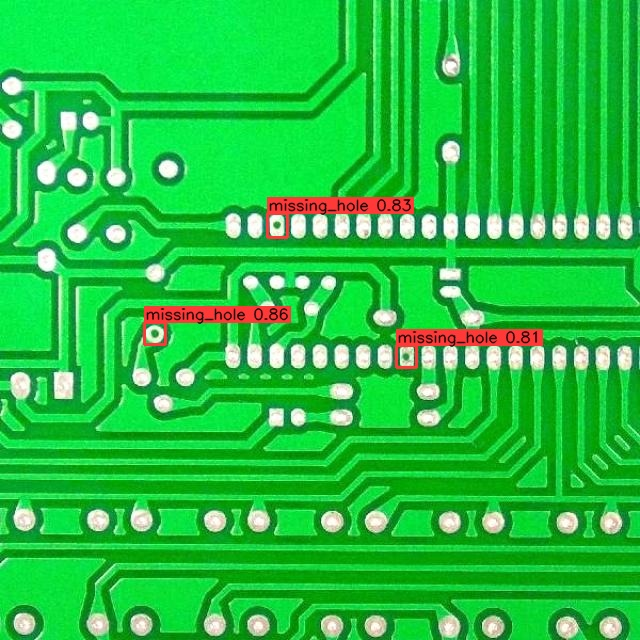
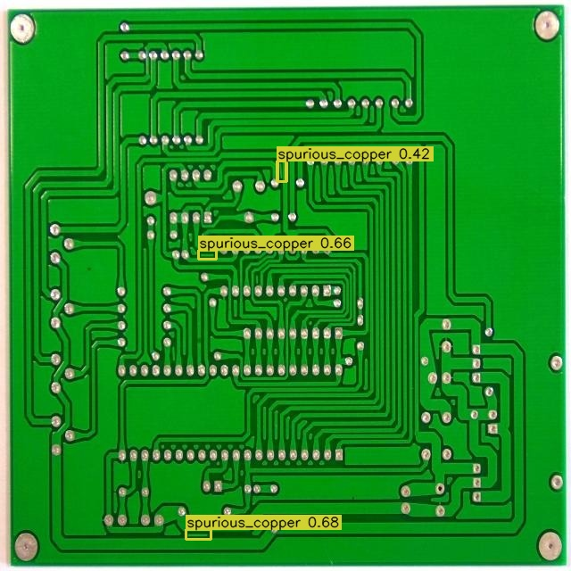

# PCB Defect Detection - YOLO26n

## Table of Contents

- [Introduction](#introduction)
- [Project Files](#project-files)
- [Requirements](#requirements)
- [Model Download](#model-download)
- [Configure](#configure)
- [How To Run](#how-to-run)
- [How To See The Output](#how-to-see-the-output)
- [Compile Model Pack](#compile-model-pack)

---

## Introduction

This app runs a folder of PCB images through a custom YOLO26n defect-detection model on the
Modalix DevKit. It draws class-colored boxes on each image and writes annotated JPGs to
`./output`.

The model detects six PCB manufacturing defects:

```text
missing_hole, mouse_bite, open_circuit, short, spur, spurious_copper
```

Dataset and Model (pt/onnx) reference: [PCB defects detection](https://platform.ultralytics.com/muhammadrizwanmunawar/datasets/pcb-defects-detection).



## Project Files

- App entry point: `./main.py`
- Runtime config: `./config/default.conf`
- Input images: `./images`
- Output images: `./output`
- BF16 compiled model pack: `./assets/models/latest_plc_yolo26n_mpk.tar.gz`

Run all commands below from this app folder:

```bash
cd /path/to/demo-neat/apps/pcb-defect-detection-yolo26n
```

## Requirements

Run from the SiMa SDK shell where `sima-cli` and `dk` are available, and where `/workspace` is
shared with the DevKit.

The precompiled BF16 model pack is required before running:

```text
./assets/models/latest_plc_yolo26n_mpk.tar.gz
```

## Model Download

The model is custom-trained, so it is not in the SiMa Model Zoo. It is shared from a Google Drive
folder, which has no command-line download:

1. Open the
   [model folder](https://drive.google.com/drive/folders/13AcEIWG3mBlTmEgNa1IjWlOL_leyjni5?usp=sharing)
   in a browser and download the BF16 model pack `latest_plc_yolo26n_mpk.tar.gz`. Keep it as a
   `.tar.gz`; do not extract it.
2. Copy it into this app's `./assets/models/` (under `~/workspace` on the host):

   ```bash
   mkdir -p ./assets/models
   cp <download-dir>/latest_plc_yolo26n_mpk.tar.gz ./assets/models/
   ```

Only `latest_plc_yolo26n_mpk.tar.gz` is needed to run inference. The same folder also has the
trained weights, `yolo26n.pt`, and the `.onnx` files; download `yolo26n.pt` into
`./assets/models/` the same way only if you want to rebuild the BF16 model pack (see
[Compile Model Pack](#compile-model-pack)).

The model pack is built from YOLO26's end-to-end (`one2one`) head, which returns one box per
defect. Neat decodes it on the board with `BoxDecodeType.YoloV26`, which runs no NMS, so the app
needs none either.

## Configure

Default runtime settings are in `./config/default.conf`:

```text
model=./assets/models/latest_plc_yolo26n_mpk.tar.gz
input_dir=./images
output_dir=./output
output_suffix=_detected
infer_size=640
score=0.25
nms=0.45
top_k=300
timeout_ms=8000
labels=missing_hole,mouse_bite,open_circuit,short,spur,spurious_copper
```

CLI flags override config values.

## How To Run

Run with the default config:

```bash
dk ./main.py \
  --config ./config/default.conf
```

Run with a stricter score threshold:

```bash
dk ./main.py \
  --config ./config/default.conf \
  --score 0.30
```

`nms` has no effect with this end-to-end model: the YoloV26 decoder runs no NMS.

After the run, annotated images are written to:

```text
./output/<image-name>_detected.jpg
```



## How To See The Output

This app is **image-in / image-out** — it does not publish a video stream. It reads every image in
`input_dir` and writes an annotated copy to `output_dir`:

```text
./images/pcb_01_missing_hole.jpg   ->   ./output/pcb_01_missing_hole_detected.jpg
```

The suffix comes from `output_suffix` in `./config/default.conf` (default `_detected`).

```bash
ls ./output/
```

Open any of them to see the detected defects boxed and labelled. Five sample PCB images ship in
`./images/`, so the app is runnable as soon as you have the model pack.

## Compile Model Pack

Use this section only if you want to rebuild the BF16
`./assets/models/latest_plc_yolo26n_mpk.tar.gz` from the trained model, `./assets/models/yolo26n.pt`.

Export the ONNX with the end-to-end head, in a Python environment with `ultralytics` installed:

```bash
python - <<'EOF'
from ultralytics import YOLO
model = YOLO("./assets/models/yolo26n.pt")
model.model.model[-1].end2end = True   # export the one2one (NMS-free) head
model.export(format="onnx", imgsz=640, opset=17, simplify=True, end2end=True)
EOF
# -> ./assets/models/yolo26n.onnx (output [1, 300, 6])
```

Without the end-to-end head, the archive returns several overlapping boxes per defect.
`surgery_einsum_attention.py` prints a warning when the ONNX has no `one2one` head.

Activate the model compiler environment from the Neat SDK host system:

```bash
source /sdk-extensions/model-compiler/bin/activate
```

Run graph surgery to expose raw YOLO heads and convert C2PSA attention to BF16-friendly
Einsum nodes:

```bash
python ./compile/surgery_einsum_attention.py \
  --model_path ./assets/models/yolo26n.onnx \
  --out ./assets/models/yolo26n_einsum_raw.onnx
```

Compile the prepared ONNX with BF16 quantization and MLA tessellation:

```bash
python ./compile/compile_yolo26_modelsdk.py \
  --model ./assets/models/yolo26n_einsum_raw.onnx \
  --build-dir ./compile/build/latest_yolo26n_compile \
  --strict-one-mla \
  --json-output ./compile/latest_compile_report.json
```

Copy the generated pack to the runtime model path:

```bash
cp -f $(find ./compile/build/latest_yolo26n_compile -name '*_mpk.tar.gz' | head -n1) \
  ./assets/models/latest_plc_yolo26n_mpk.tar.gz
```

The final pack is:

```text
./assets/models/latest_plc_yolo26n_mpk.tar.gz
```
