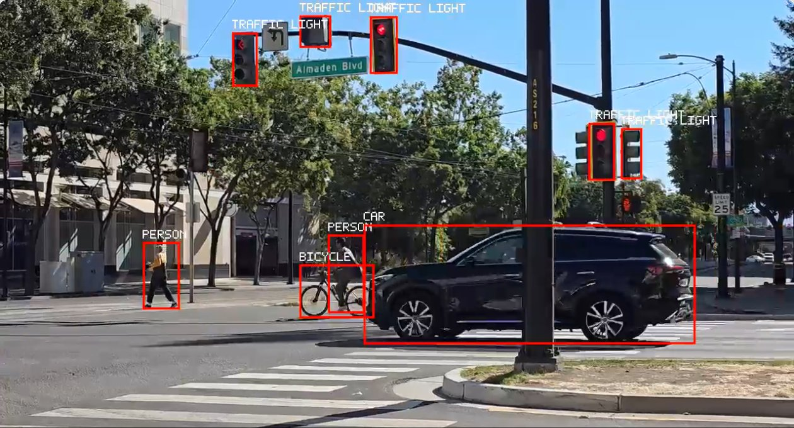

# Single Stream YOLO26n Detection

## Table of Contents

- [Introduction](#introduction)
- [About Project](#about-project)
- [Requirements](#requirements)
- [Model Download Command](#model-download-command)
- [Configure](#configure)
- [Config Parameters](#config-parameters)
- [How To Build](#how-to-build)
- [How To Run](#how-to-run)
- [How To Run With Python](#how-to-run-with-python)
- [How To See The Output](#how-to-see-the-output)

---

## Introduction

This demo runs one RTSP stream through the SiMa YOLO26n detection model, draws labeled boxes, and
publishes one annotated H.264/RTP UDP stream.



*YOLO26n detections (C++ app) on a 1280×720 street stream, viewed in Neat Insight.*

## About Project

- Application: `single_stream_yolo26n`
- Model: `yolo26n-det-bf16-mla_tess-b1.tar.gz`
- Input: RTSP H.264 stream
- Output: one UDP/RTP H.264 stream with labeled boxes
- Runtime config: `./config/default.conf`

## Requirements

Run build commands from the Modalix SDK/eLxr environment where the Modalix SDK sysroot
and `dk` are available. Run the final binary on the DevKit with `dk`.


Run the commands below from this app folder:

```bash
cd /path/to/demo-neat/apps/single-stream-yolo26n
```

## Model Download Command

Run this in the SDK shell:

```bash
mkdir -p ./assets/models
cd ./assets/models
sima-cli download https://docs.sima.ai/pkg_downloads/SDK2.1.3/models/modalix/yolo26-detection/yolo26n-det-bf16-mla_tess-b1.tar.gz
cd ../..
```

Expected model path:

```text
./assets/models/yolo26n-det-bf16-mla_tess-b1.tar.gz
```

## Configure

Edit `./config/default.conf` before running. At minimum, set:

```text
rtsp_url=<rtsp-url>
model_path=./assets/models/yolo26n-det-bf16-mla_tess-b1.tar.gz
udp_host=<host-ip>
udp_port=9000
```

The app stops at start with `set rtsp_url in ...` (or `udp_host`) while a value is still a
`<...>` placeholder.

> **Resolution and frame rate are read from the camera at start.** `width`, `height` and `fps`
> in the config are used only if that fails; then set them to your camera's values.
> Reading the camera needs `ffprobe` on the DevKit (`sudo apt install ffmpeg`). If it fails, the
> app prints `[warn] could not probe <url> (<reason>)` and continues with the config values.

For a bounded C++ smoke test, set `frames=30` in `./config/default.conf`.

## Config Parameters

<details>
<summary>Click to expand</summary>

<br>

`rtsp_url`: RTSP H.264 input stream consumed by the source graph.

`rtsp_transport`: RTSP transport mode. Use `tcp` for reliability or `udp` for lower latency.

`udp_host`: Host/IP that receives the annotated UDP/RTP output stream.

`udp_port`: UDP/RTP output port used by the H.264 video sender.

`model_path`: Model archive loaded by the Neat model node.

`model_width`: Model input width used by Neat preprocessing.

`model_height`: Model input height used by Neat preprocessing.

`width`: Width of the RTSP stream. Fallback, used only if the camera cannot be read.

`height`: Height of the RTSP stream. Fallback, used only if the camera cannot be read.

`fps`: Frame rate of the RTSP stream (whole number). Fallback, used only if the camera cannot be read.

`probe_source`: `true` reads width, height and fps from the camera at start; `false` uses the values above.

`latency_ms`: RTSP receiver latency buffer in milliseconds.

`score_threshold`: Detection score threshold used by YOLO26 box decode.

`nms_iou`: Ignored by this app. YOLO26 is NMS-free, so the `YoloV26` decode runs no NMS; the
key is accepted so configs stay interchangeable with the other single-stream apps.

`top_k`: Maximum decoded detections or instances per frame.

`num_classes`: Number of classes in the model output.

`frames`: Number of frames to process. Use `0` to run until interrupted.

`bitrate_kbps`: H.264 output encoder bitrate in kbps.

`print_backend`: Print generated backend pipelines when set to `true`.

</details>

## How To Build

Run from the SDK shell:

```bash
cmake -S . \
  -B ./build \
  -DCMAKE_BUILD_TYPE=Release \
  -DCMAKE_PREFIX_PATH=/opt/toolchain/aarch64/modalix/usr
cmake --build ./build --parallel
```

## How To Run

Run on the DevKit from the SDK shell. The C++ demo reads `./config/default.conf`; it does not use
`--config` or `--frames` command-line flags.

```bash
dk ./build/single_stream_yolo26n
```

For a bounded C++ smoke test, set `frames=30` in `./config/default.conf`, then run the same command.

Expected output (C++; a receiver example is also printed after the `UDP output` line):

```text
RTSP input: <rtsp-url>
Model:      ./assets/models/yolo26n-det-bf16-mla_tess-b1.tar.gz
UDP output: udp://<host-ip>:9000 H264/RTP payload=96 1280x720@60
Running. Press Ctrl-C to stop.
[visualize] frame=30 boxes=<n> sample_frame_id=<id> fps=<run fps> steady_fps=<fps after frame 1> ms(decoder=..., inference=..., overlay=..., encoder=..., total=...) avg_ms(decoder=..., inference=..., overlay=..., encoder=..., total=...)
```

The C++ app prints a `[visualize]` line for frame 1, then every 30 frames, and for the last frame
when `frames` is set.
`ms(...)` is the time each stage took for that frame and `avg_ms(...)` the average since start, in
milliseconds. The Python app prints the same timing fields in the form
`frame=<n> detections=<n> visible=<n> fps=... steady_fps=... ms(...) avg_ms(...)`.

If the RTSP source sends no frame for three 20-second waits in a row, the app stops with
`[err] no RTSP frame after 3 consecutive timeouts; giving up`, so a bounded run always ends.

## How To Run With Python

Run the Python version on the DevKit from the SDK shell:

```bash
dk ./main.py \
  --config ./config/default.conf
```

Bounded smoke test:

```bash
dk ./main.py \
  --config ./config/default.conf \
  --frames 30
```

## How To See The Output

### Neat Insight (recommended)

**Neat Insight** decodes and displays the stream in a browser — nothing to install on your machine,
and it works from any device that can reach the host.

1. Open the Insight UI, **`https://<sdk-host-ip>:9900`** (`neat --json` shows it as
   `insight.webUiUrl`), in a browser. *It is **HTTPS**, not HTTP. The SDK uses a local mkcert
   certificate, so accept the browser warning the first time.*
2. Go to the **Video Viewer** tab.
3. Set **Port** to **9000** — the same value as `udp_port` in `./config/default.conf`.
   Insight ingests video on UDP `9000 + channel`, so channel 0 is port `9000`.

Make sure `udp_host` in `./config/default.conf` points at the machine running Insight — that is
where the app sends the RTP stream. The number of video channels is set by the SDK's port map;
read the range from `neat --json` (`exposedPorts`, `videoUDP`) rather than assuming.
