# NEAT Installation & Setup Guide

Install the NEAT SDK on your host, pair it with a Modalix DevKit, and attach VS Code.

> **On Windows?** Follow [`neat_on_windows.md`](neat_on_windows.md) instead — same stack, via WSL2.

**Also in this folder:** [`components.md`](components.md) (what each piece of the stack is) ·
[`neat_insight.md`](neat_insight.md) (browser-based RTSP sources, viewer, runtime metrics)

## Table of Contents

- [1. Prerequisites](#1-prerequisites)
- [2. Install](#2-install)
- [3. The decisions you'll make](#3-the-decisions-youll-make)
- [4. Attach VS Code](#4-attach-vs-code)
- [5. Run something on the DevKit](#5-run-something-on-the-devkit)
- [Troubleshooting](#troubleshooting)
- [Appendix](#appendix)
  - [Detailed walkthrough with screenshots](#detailed-walkthrough-with-screenshots)
  - [VS Code, step by step](#vs-code-step-by-step)
  - [Optional: Model Compiler](#optional-model-compiler)
- [References](#references)

---

## 1. Prerequisites

- **Host OS:** Ubuntu 22.04 / 24.04 (recommended), Windows 11 via WSL (x86_64), or macOS 15.5+
  Apple Silicon (aarch64).
- **Tools:** `sudo` access, Git, `curl` / `wget`, and a container runtime (Docker or Colima).
- **Host resources:** 4 CPU cores, 16 GB RAM and 100 GB free disk minimum (the Model Compiler
  adds about 20 GB).
- **Network:** the host and the Modalix DevKit must reach each other — confirm you can `ping` the
  DevKit IP from the host.

Install `sima-cli` on the host:

```bash
curl -fsSL https://artifacts.neat.sima.ai/sima-cli/linux-mac.sh | bash
```

---

## 2. Install

**On the host**, run:

```bash
sima-cli neat install sdk@release-2.1
```

This is the default install for current boards. It is one continuous flow — there is no separate
setup command to run afterwards.

**What the command does**

1. Pulls the NEAT SDK Docker image.
2. Creates the SDK container and installs the SDK software into it.
3. Pairs with the Modalix DevKit.
4. Shares one workspace folder between the host, the SDK container, and the DevKit — so you never
   copy files by hand.
5. Installs Neat Core on the SDK container, and on the paired DevKit if you paired one.

`release-2.1` tracks the latest patch in the 2.1 series: **SDK 2.1.3.1** (Neat Library 0.5.0), which
pairs with **DevKit software 2.1.3**. The first install takes several minutes.

**Not sure which SDK your board needs?** Check what it's running with `cat /etc/buildinfo` on the
DevKit, then look it up in the
[compatibility matrix](https://developer.sima.ai/software/getting-started/compatibility).

---

## 3. The decisions you'll make

Setup is a series of prompts. Everything you have to decide is in this table — the rest is `Enter`,
except prompt 6 on a repeat run.

| # | Prompt | Choose | Notes |
|---|---|---|---|
| 1 | **Pair this SDK with a DevKit now?** `[y/N]` | `y`, then enter the DevKit IP | e.g. `192.168.XXX.XXX`. Press `N` if you don't have the IP yet — the workspace is still created and you can pair later with `sima-cli sdk setup --devkit <devkit-ip>`. |
| 2 | **Some system checks failed — continue anyway?** `[y/N]` | `y` — *if* the only failure is a `Firewall` `WARNING` | Any other failure is worth reading before you continue. |
| 3 | **SDK Docker image** | `Enter` | The image you just downloaded is pre-selected. |
| 4 | **Host workspace path** | `Enter` if the default is `~/workspace`; otherwise type `~/workspace` | The guides assume `~/workspace`. This folder is shared with the DevKit, so you never copy files by hand. |
| 5 | **SDK extension** | `Enter` | |
| 6 | **Container … already exists** — `Remove and recreate it? [Y/n]` | **First install:** let setup create the container. **Every later run:** type `n`. | ⚠️ The one prompt that actually matters. The default is `Y`: pressing `Enter` (or `y`) removes the existing container and recreates it from scratch. Answer `n` to reuse it. |
| 7 | **Install the Model Compiler extension?** | `n`, unless you need to compile ONNX/GenAI models | Optional. ~15 minutes and about 20 GB of disk. You can [add it later](#optional-model-compiler). |
| 8 | **DevKit workspace path** | `Enter` for `/workspace` | Mounts your host workspace onto the board. If it asks for a password, it's `edgeai`. |

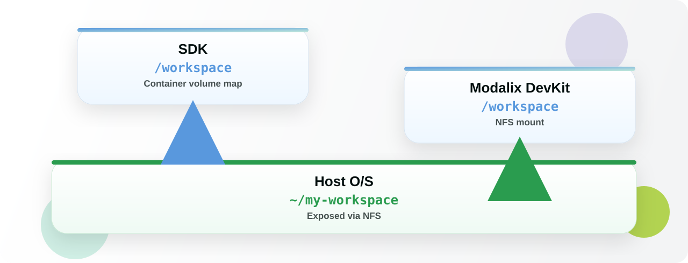

**Running setup again later?** You don't reinstall or re-pull anything. Just:

```bash
sima-cli sdk setup --devkit <devkit-ip>
```

…and answer `n` at prompt 6 (`Container '…' already exists. Remove and recreate it? [Y/n]`) to reuse
the existing container. `Enter` accepts the default `Y` and recreates it.

---

## 4. Attach VS Code

1. Install [VS Code](https://code.visualstudio.com/download) on the host. On Ubuntu:

   ```bash
   sudo apt update && sudo snap install code --classic
   ```

2. Install the **Dev Containers** extension by Microsoft.

3. Open the Command Palette (`Ctrl+Shift+P`) → **Dev Containers: Attach to Running Container…** →
   pick the `sima-neat/sdk` container.

4. In the attached window, open `/workspace`.

5. Optionally install the **Codex** or **Claude Code** extension with **Install in Container**, and
   confirm "List available skills" shows the SiMa skills (for example `neat-application-builder`) —
   see [Chapter 19](../devkit-quick-start/chapters/19-agentic-development.md).

Screenshots for each of these steps are in the [detailed walkthrough](#detailed-walkthrough-with-screenshots) below.

---

## 5. Run something on the DevKit

From inside the attached SDK container, use `dk` to execute on the paired board:

Smoke test — save as `hello_neat.py`, then `dk hello_neat.py`:

```python
import pyneat
print("pyneat import successful")
```

```bash
dk hello_neat.py            # a PyNeat script
dk build/<binary-name>       # a compiled C++ binary (Chapter 18 builds one)
```

If that prints, the runtime is live on the DevKit. Next: the
[tutorial notebooks](../tutorial/README.md), or straight to an [app](../README.md#3-apps).

---

## Troubleshooting

| Symptom | Fix |
|---|---|
| Version mismatch | `cat /etc/buildinfo` on the board, then pin the SDK and model-compiler versions to match. |
| Pairing fails | Confirm host and DevKit are on the same network and can `ping` each other; check firewall rules. |
| Setup reinstalls everything | You accepted the default `Y` (or pressed `Enter`) at prompt 6. Answer `n` to reuse the existing container. |
| Copying files by hand | Don't — use the shared `/workspace` set up by pairing. |

**NEAT Insight** is bundled with the SDK; run `neat` in the SDK for its URL — the **Insight (local)**
URL, usually `https://127.0.0.1:9900` — use it to inspect streams,
files, and runtime logs. See [neat_insight.md](neat_insight.md).

---

## Appendix

### Detailed walkthrough with screenshots

<details>
<summary>Click to expand</summary>

<br>

Every prompt from Section 3, in order, as it actually appears.

**Install starts.** `sima-cli neat install sdk@release-2.1` validates the release metadata and
downloads the SDK image.

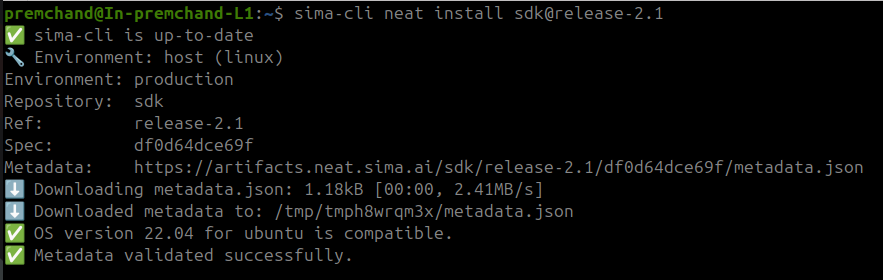

**Prompt 1 — pair with a DevKit.** Setup starts automatically once the image is local. Press `y`,
then type the DevKit IP inline.

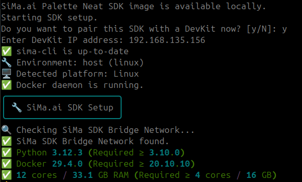

**Prompt 2 — system requirements report.** If the only red mark is a `Firewall` `WARNING`, press
`y` to continue.

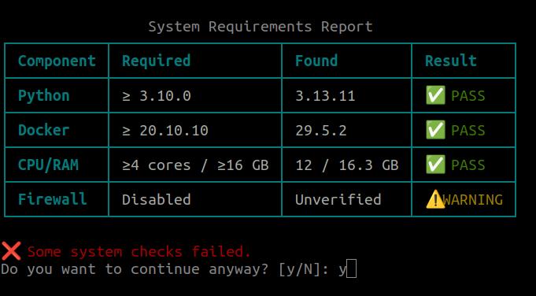

**Prompt 3 — SDK Docker image.** The image you downloaded is pre-selected; press `Enter`.

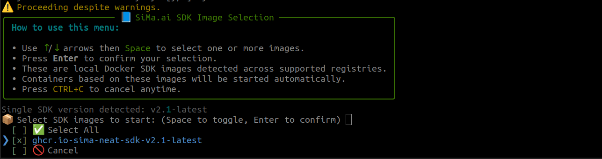

**Prompt 4 — host workspace.** Press `Enter` if the default is `~/workspace`; if the default differs,
type `~/workspace`.

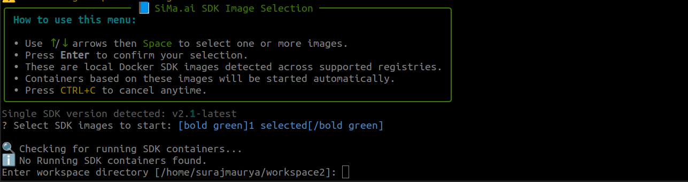

**Prompt 5 — SDK extension.** Press `Enter`.

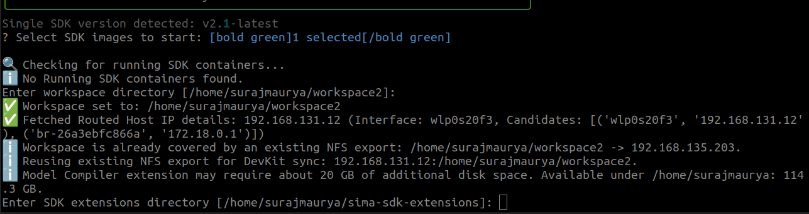

**Prompt 6 — container reuse.** ⚠️ On a first install, let setup create the container. On every
later run, setup asks `Container '…' already exists. Remove and recreate it? [Y/n]` — type `n` to
reuse it. The default `Y` (`Enter`) removes the container and recreates it.

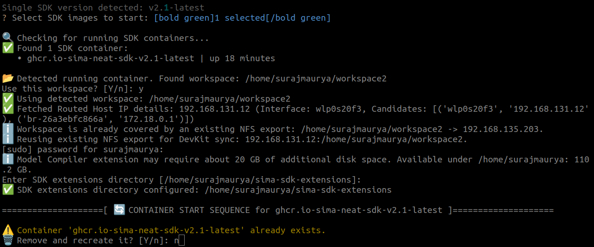

**Prompt 7 — Model Compiler.** Skip unless you need to compile models. ~15 min, about 20 GB of disk.

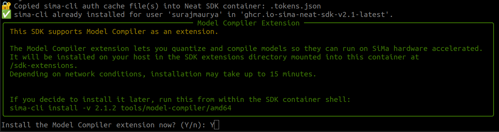

**Prompt 8 — DevKit workspace.** `Enter` accepts `/workspace` on the board. Password, if asked:
`edgeai`.

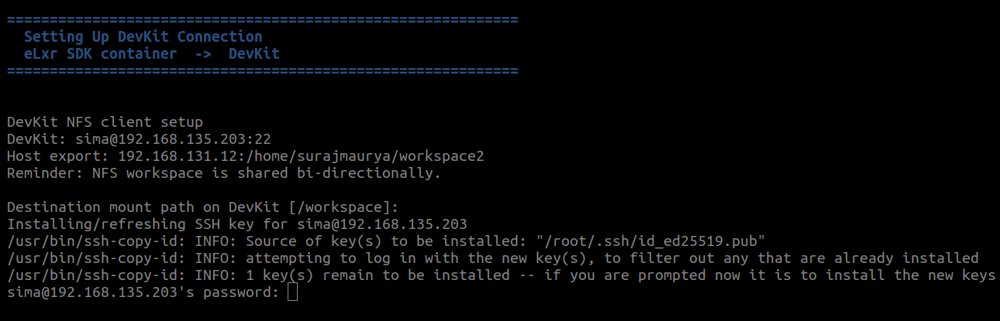

**Done.** Confirm the installation reports success.

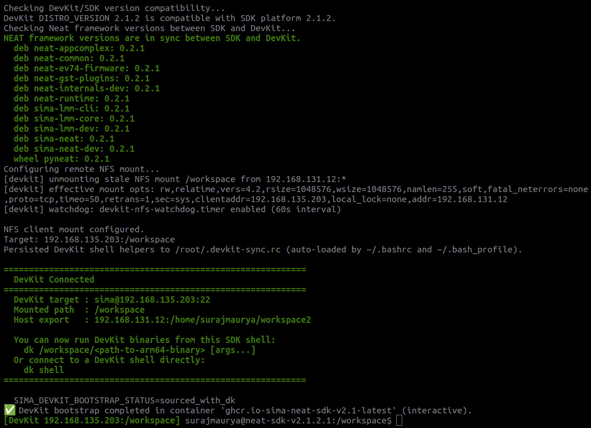

### VS Code, step by step

Command Palette → **Dev Containers: Attach to Running Container…**

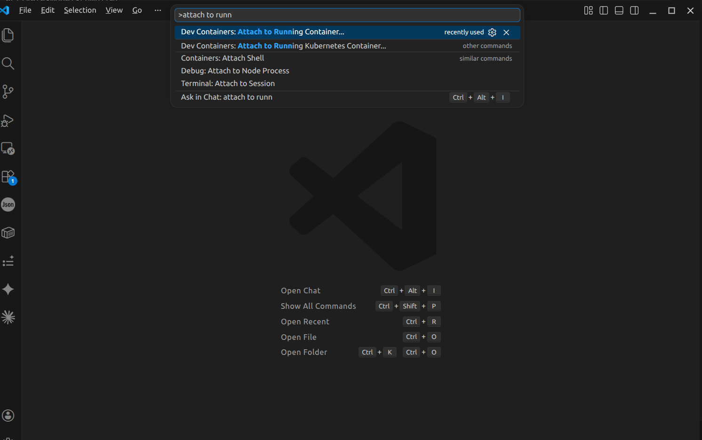

Select the `sima-neat/sdk` container.

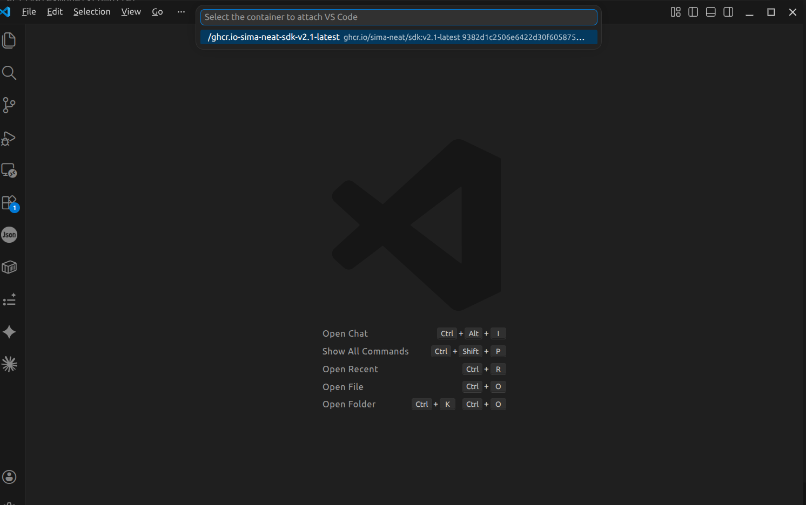

In the attached window, open `/workspace`.

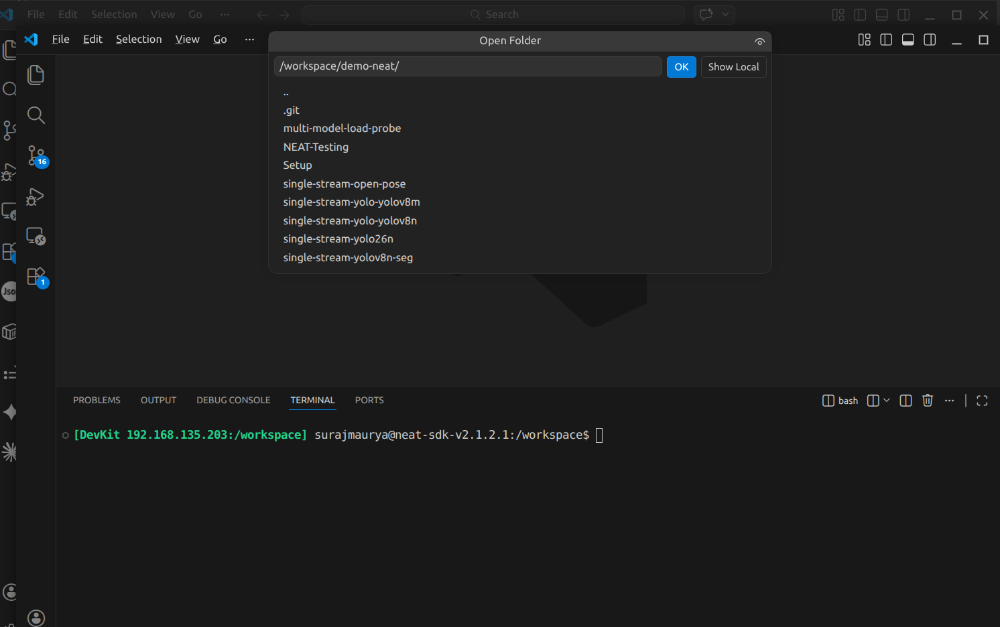

Install the `Claude` or `Codex` extension for agentic development.

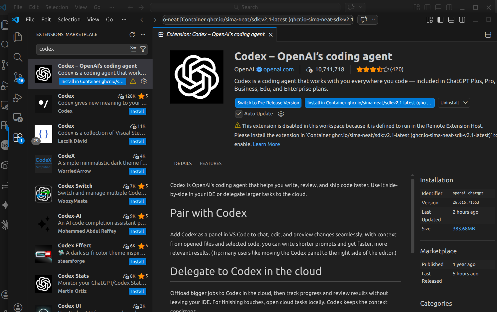

Confirm the SiMa skills are picked up ("List available skills").

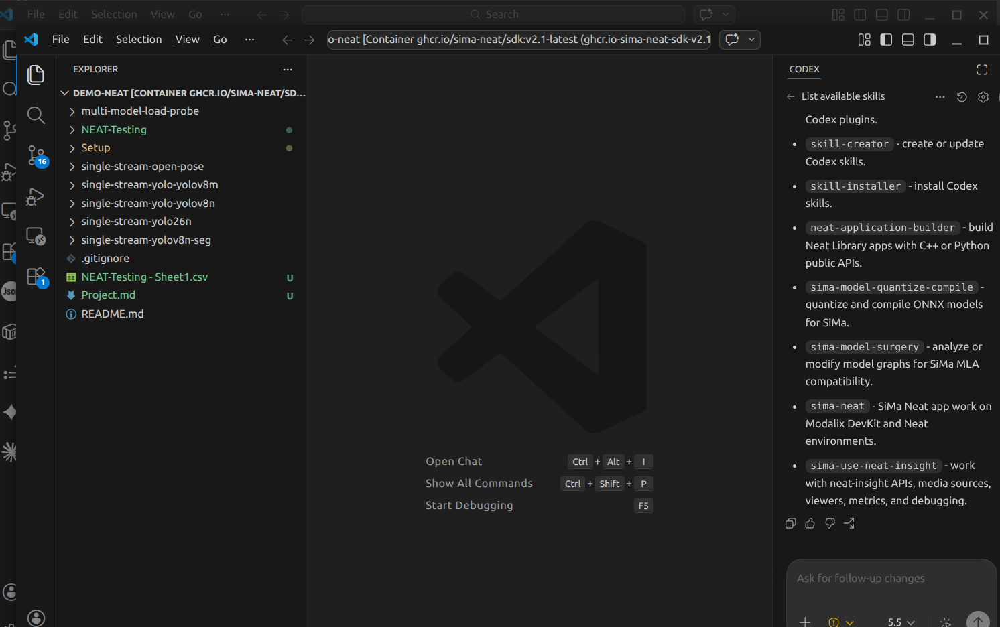

</details>

---

### Optional: Model Compiler

<details>
<summary>Click to expand</summary>

<br>

Only needed to compile or quantize ONNX / GenAI models for Modalix. Match the architecture
(amd64/arm64) and version to your board and SDK.

```bash
# amd64, v2.1.3 (matches DevKit software 2.1.3)
sima-cli install -v 2.1.3 tools/model-compiler/amd64
```

References:
[Installation Guide](https://developer.sima.ai/software/getting-started/dev-environment/install-model-compiler) ·
[Compatibility](https://developer.sima.ai/software/getting-started/compatibility#model-compiler) ·
[Compile a model](https://developer.sima.ai/software/compile-a-model/)

</details>

---

## References

- [Getting started](https://developer.sima.ai/software/getting-started/) — primary reference
- [Install the environment](https://developer.sima.ai/software/getting-started/dev-environment/install-the-environment/)
- [Pair with a DevKit](https://developer.sima.ai/software/getting-started/dev-environment/pair-with-a-devkit/)
- [Compatibility matrix](https://developer.sima.ai/software/getting-started/compatibility/)
- [Compile a model](https://developer.sima.ai/software/compile-a-model/)
- [Hello NEAT](https://developer.sima.ai/software/develop-apps/hello-neat/minimal/)
